<p align="center">
  <a href="https://jeanfbrito.github.io/sixmart/">
    <picture>
      <source media="(prefers-color-scheme: dark)" srcset="docs/img/hero-dark.png">
      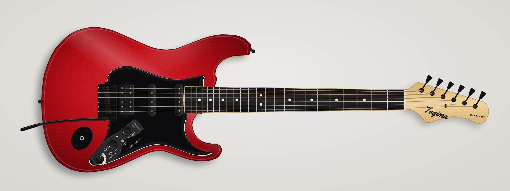
    </picture>
  </a>
</p>

<h1 align="center">Tagima Sixmart Explorer</h1>

<p align="center">
  One web page about one guitar, drawn at real scale.<br>
  Zoom to any part, set it up, set the built-in effects and learn riffs on the real fretboard.
</p>

<p align="center">
  <a href="https://jeanfbrito.github.io/sixmart/"><b>▶ Open the live page</b></a>
  · <a href="API.md">Preset and riff API</a>
  · <a href="AGENTS.md">Guide for coding agents</a>
</p>

<p align="center">
  <a href="https://jeanfbrito.github.io/sixmart/"></a>
  
  
  
</p>

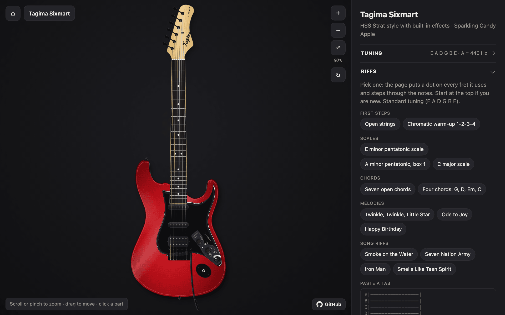

## What you can do

|  |  |
| --- | --- |
| 🔍 **Explore** | Pan and zoom the guitar. Click any of its 26 parts for its specs, setup values and notes. |
| 🔧 **Set it up** | Follow 9 guides with diagrams: neck relief, truss rod, action, intonation, pickup height, tremolo float, nut slots and string winding. |
| 🎛️ **Set the effects** | Set the real controls by hand. Save each sound with a name, and export your sounds as a JSON file. |
| 🔗 **Open a preset** | Open a link from an agent or a script. The page turns the knobs, puts numbered callouts on the controls and lists the steps. |
| 🎸 **Learn a riff** | See a dot on each fret that the riff uses, the tab in the panel, and each note in order. The page has 14 examples. |
| ↻ **Turn it as worn** | Turn the guitar horizontal, as it hangs when you wear it. |
| 🌗 **Any screen** | Use the light or the dark theme, on a computer or a phone. |

## The guitar

The Tagima Sixmart is an HSS Strat-style guitar with effects inside it. A
battery powers the effects. The page shows the owner's guitar:

|  |  |
| --- | --- |
| **Body** | Basswood · 319 × 466 mm · Sparkling Candy Apple |
| **Neck** | Bolt-on maple · C shape |
| **Fretboard** | Techwood · 9.5" (241 mm) radius · 22 frets |
| **Scale length** | 25.5" (648 mm) |
| **Nut width** | 43 mm |
| **Pickups** | Humbucker at the bridge, single coils in the middle and at the neck |
| **Bridge** | Tremolo with 6 saddles, black |
| **Tuners** | Diecast, black |
| **Effects** | Distortion, overdrive, delay and reverb · LED · headphone out · rec out and audio in |

These values come from the retailer listing and the owner's photos. Each
row in the page shows its source (see [Sources](#sources)).

## Explore every part

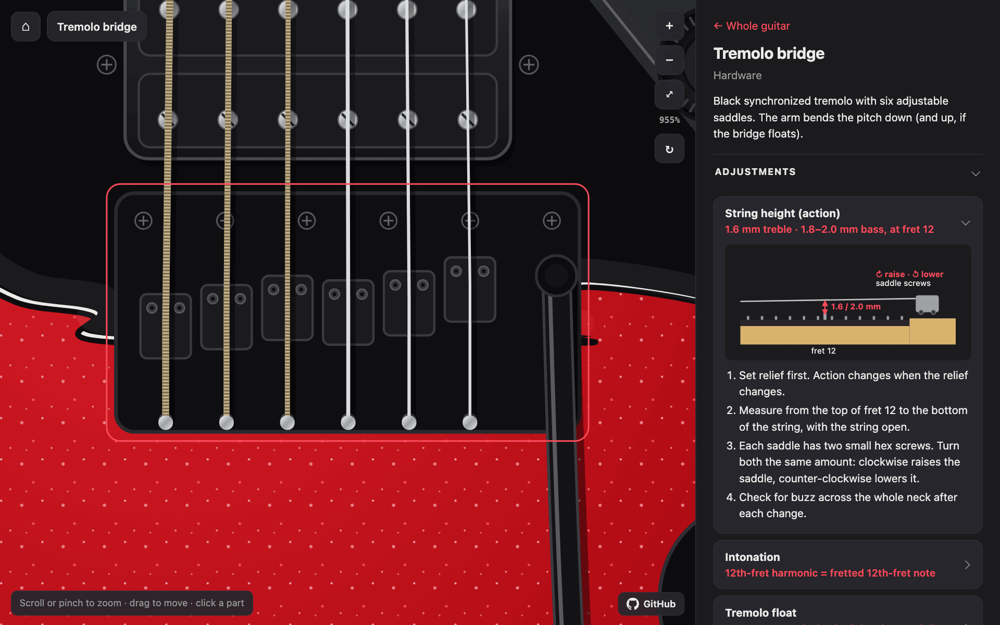

- Move the pointer over a part to see its name. Click the part to zoom to
  it and open its panel.
- Drag to move. Scroll or pinch to zoom. A double click zooms in. The
  <kbd>+</kbd> and <kbd>-</kbd> keys zoom, and <kbd>Esc</kbd> shows the
  whole guitar again.
- Each part has a link: [`#bridge`][part-bridge], [`#neck`][part-neck],
  [`#tuners`][part-tuners] and 23 more.
- A part panel has the setting of its control, the setup guides, the
  tuning, setup notes and the specs.

## Set up the guitar

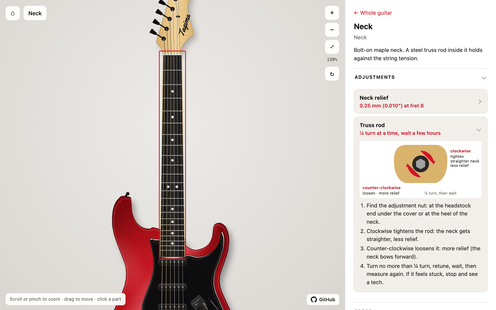

The **Setup** list in the overview gives a good order. Each guide has a
target value, steps and a diagram:

| # | Guide | Target |
| :-: | --- | --- |
| 1 | New strings and tuning | E standard, A = 440 Hz · 2–3 wraps on wound strings, 3–5 on plain |
| 2 | Neck relief | 0.25 mm (0.010") at fret 8 · turn the truss rod ¼ turn at a time, then wait a few hours |
| 3 | Action | 1.6 mm treble · 1.8–2.0 mm bass, at fret 12 |
| 4 | Nut slot height | ≈ 0.5 mm treble · 0.6 mm bass, open string over fret 1 |
| 5 | Pickup height | Single coils 2.4 mm bass · 2.0 mm treble · humbucker 1.6 mm both sides |
| 6 | Intonation | 12th-fret harmonic = fretted 12th-fret note |
| 7 | Tremolo float | ≈ 3 mm gap at the back of the plate, or fully decked |

> [!NOTE]
> These targets are general Strat setup values, not factory values for this
> guitar. Measure before you turn a screw.

## Set the effects by hand

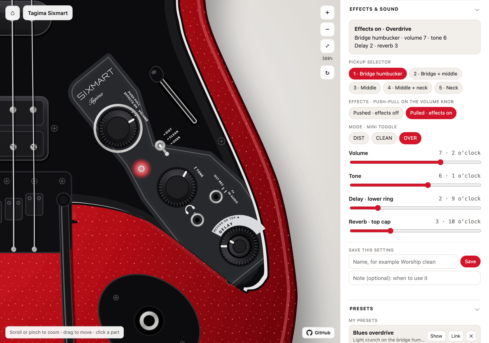

The **Effects & sound** section has every control of the guitar. When you
change a control in the panel, the knob, the switch or the LED on the
drawing changes too:

| Control | On the guitar |
| --- | --- |
| Pickup selector | 5-way switch. 1 = bridge humbucker, 5 = neck pickup |
| Effects | Push-pull on the VOLUME knob. Pull it up: the effects turn on and the LED lights |
| Mode | Mini toggle: DIST (distortion), CLEAN or OVER (overdrive) |
| Volume, Tone | Knobs, 0 to 10 |
| Delay | The big lower ring of the stacked knob |
| Reverb | The small cap on top of the stacked knob |

The knobs have no printed numbers. Thus the page also gives each value as
a clock position: 0 is 7 o'clock, 5 is 12 o'clock and 10 is 5 o'clock.

Give a setting a name and click **Save**. The **Presets** section keeps
your sounds. **Export JSON** writes them to a file, and **Import JSON**
reads them back on another computer.

## Open a preset from a link

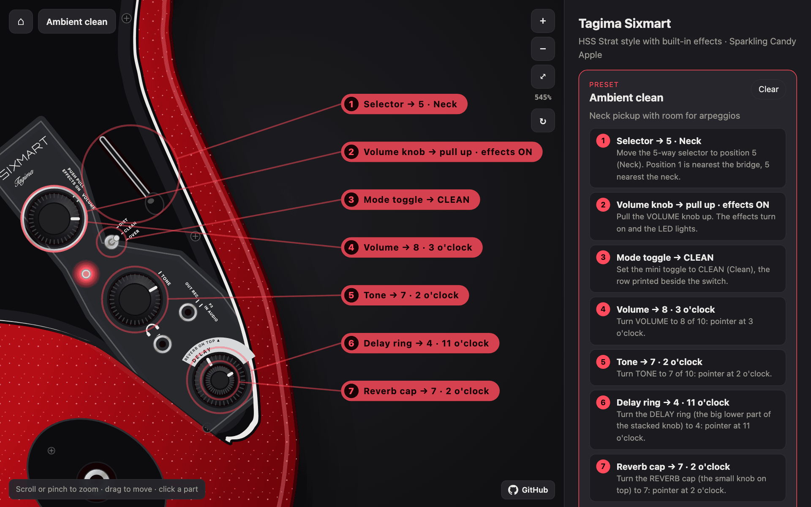

Put the controls in the link. The page sets the knobs, draws numbered
callouts on the real controls and lists the steps in the order a player
does them:

```
https://jeanfbrito.github.io/sixmart/#pickup=5&effects=on&mode=clean&volume=8&tone=7&delay=4&reverb=7&title=Ambient+clean
```

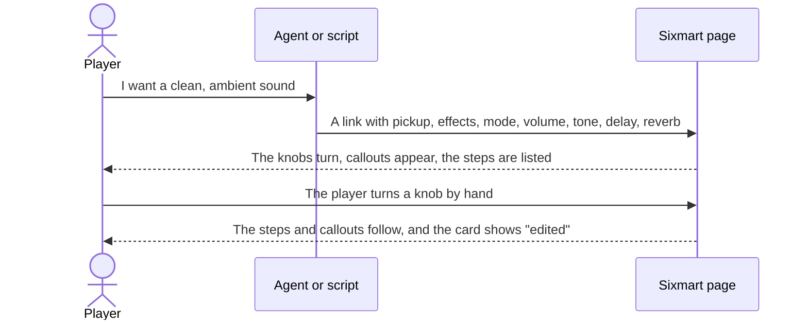

Try the 4 example presets:

| Preset | Pickup | Effects | Mode | Volume | Tone | Delay | Reverb |
| --- | :-: | :-: | :-: | :-: | :-: | :-: | :-: |
| [Plain clean][p-plain-clean] | 4 | off | CLEAN | 10 | 8 | 0 | 0 |
| [Ambient clean][p-ambient-clean] | 5 | on | CLEAN | 8 | 7 | 4 | 7 |
| [Blues overdrive][p-blues-drive] | 1 | on | OVER | 7 | 6 | 2 | 3 |
| [Lead distortion][p-lead-dist] | 1 | on | DIST | 10 | 5 | 5 | 4 |

The effect levels are not calibrated. Use the values as a start, and
listen.

## Learn a riff

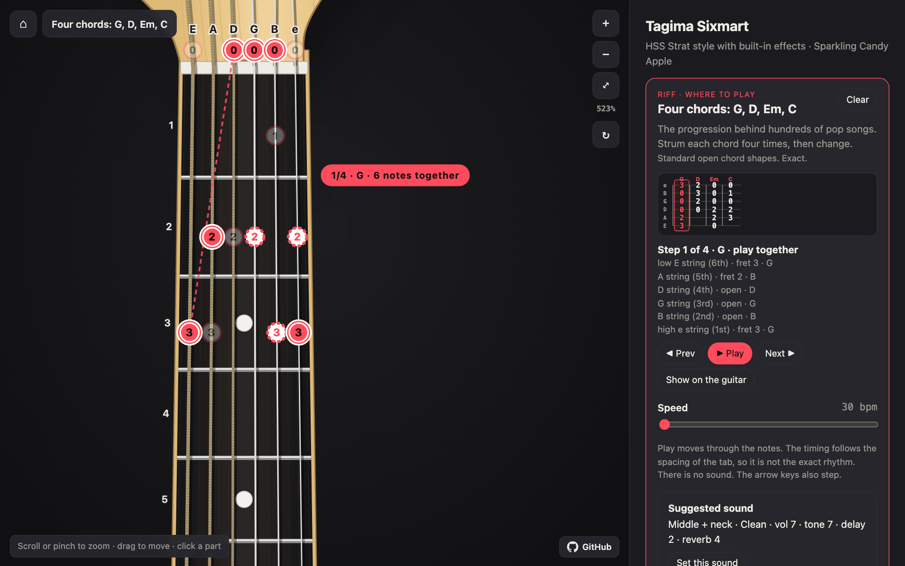

Pick a riff in the **Riffs** section, open a riff link, or paste a tab.
The page puts a dot on each fret that the riff uses and steps through the
notes:

- The current note is solid. The next note has a dashed ring, and a
  dashed line goes to it.
- A label beside the neck names the string and the fret, or the chord.
- The panel shows the tab and each step in words, with the note name.
- **Prev**, **Play** and **Next** move through the notes. The arrow keys
  also step, and a click on a tab column goes to that step.

<p align="center">
  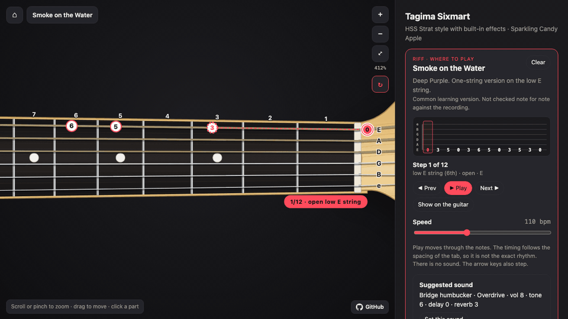
</p>

The 14 examples, in 5 groups:

| Group | Riffs |
| --- | --- |
| First steps | [Open strings][r-open-strings] · [Chromatic warm-up 1-2-3-4][r-chromatic] |
| Scales | [E minor pentatonic][r-em-pentatonic] · [A minor pentatonic, box 1][r-am-pentatonic] · [C major][r-c-major] |
| Chords | [Seven open chords][r-open-chords] · [Four chords: G, D, Em, C][r-four-chords] |
| Melodies | [Twinkle, Twinkle, Little Star][r-twinkle] · [Ode to Joy][r-ode-to-joy] · [Happy Birthday][r-happy-birthday] |
| Song riffs | [Smoke on the Water][r-smoke] · [Seven Nation Army][r-seven-nation] · [Iron Man][r-iron-man] · [Smells Like Teen Spirit][r-teen-spirit] |

Write your own riff in a link, with `riff=` and this notation:

| Write | Meaning |
| --- | --- |
| `6/3` | String 6 (low E), fret 3. Strings go from 1 (high e) to 6 (low E). Fret 0 is the open string |
| `[5/2 4/4]` | Notes played together: a chord or a power chord |
| `[G: 6/3 5/2 4/0 3/0 2/0 1/3]` | A chord with a name |
| `\|` | Bar line |
| `5/5h7` · `5/7p5` · `5/5s7` | Hammer-on · pull-off · slide |
| `3/7b9` · `5/7~` | Bend up to the pitch of fret 9 · vibrato |
| `6/x` · `(5/7)` | Muted string · ghost note |

A normal six-line ASCII tab also works, with `tab=` or in the paste box.
[API.md, section 7](API.md#7--riffs-where-to-play) has all the rules.

## Turn it as worn

<table>
  <tr>
    <td align="center" width="50%">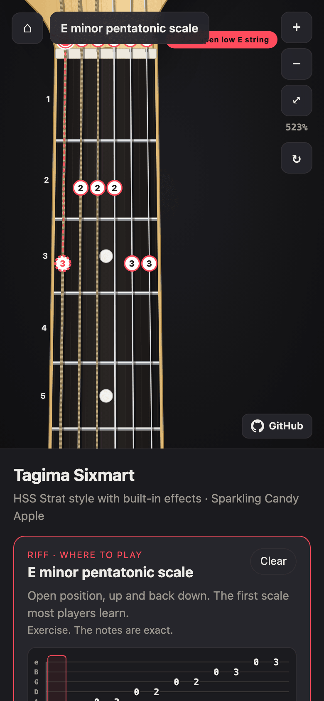<br><sub>Upright</sub></td>
    <td align="center" width="50%">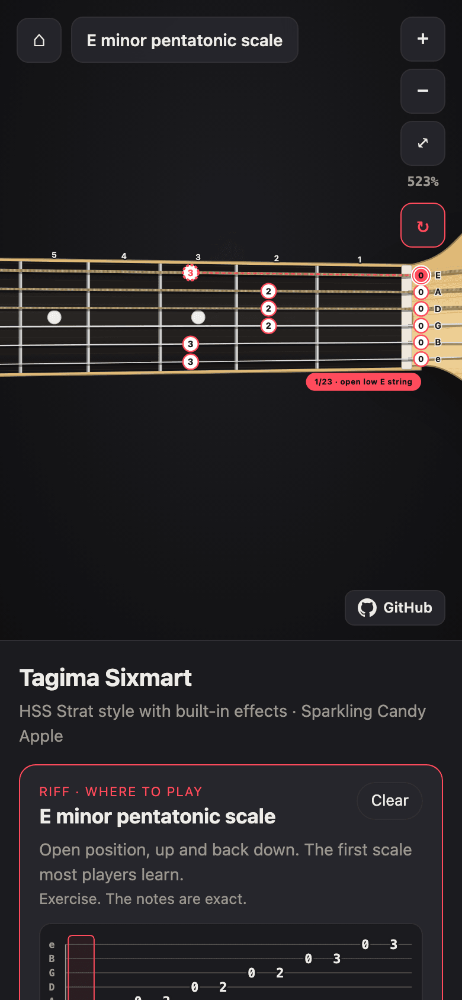<br><sub>As worn</sub></td>
  </tr>
</table>

Click **↻** in the toolbar, or press <kbd>R</kbd>. The guitar turns
horizontal, as a person in front of you sees it when you wear it. The
headstock is on the right, the low E string is on top and the knobs are at
the bottom. The labels stay level, and the page keeps your choice. On a phone,
the worn view gives each fret more room.

## For agents and scripts

An agent or a script can control the page in three ways:

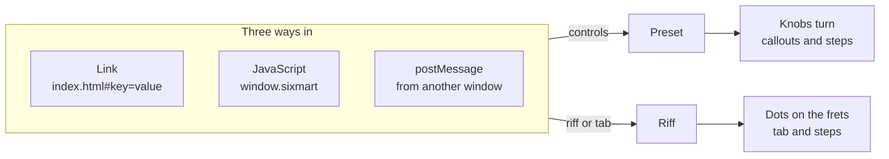

| Way in | Preset | Riff |
| --- | --- | --- |
| Link | `index.html#pickup=5&effects=on&…` | `index.html#riff=6/0+6/3+6/5&…` or `#tab=…` |
| JavaScript | `sixmart.apply(config)` | `sixmart.riff(config)` |
| postMessage | `{type: 'sixmart:apply', config}` | `{type: 'sixmart:riff', riff}` |

```js
// with the page open, for example in a browser automation tool
sixmart.apply({pickup: 5, effects: 'on', mode: 'clean', volume: 8, tone: 7, delay: 4, reverb: 7, title: 'Ambient clean'})
// → {ok, config, warnings, steps: [...], link}

sixmart.riff({riff: '5/7 5/7 5/10 5/7 5/5 5/3 5/2', title: 'Seven Nation Army', bpm: 100})
// → {ok, title, events, steps: [...], warnings, link}

sixmart.steps({volume: 8, delay: 4})   // the step text only, no change on the page
sixmart.saved()                        // the player's saved presets
```

[API.md](API.md) is the full reference. The same text is in the page at
[`#api`][api].

## How the page works

- **One file.** `index.html` holds the CSS, the drawing code, the data and
  the interaction. JavaScript builds the SVG when the page loads. The page has
  no build step, no server and no JavaScript dependency. The only external
  file is the Yellowtail font for the headstock logo. Without a network,
  the logo uses a system script font.
- **Real scale.** One drawing unit is 648/820 mm. The nut is at
  y = 250, and the scale length is 820 units (25.5" = 648 mm). The frets
  follow the 12th root of 2: `fretY(n) = NUT + SCALE × (1 − 2^(−n/12))`.
- **Traced outlines.** A script traced the body, the pickguard and the
  headstock from flat product photos: silhouette, contour, smoothing and
  Catmull-Rom curves. The fret spacing in the photo sets the scale.
- **Layers.** The `viewBox` is the camera. One group turns the whole
  drawing for the worn view. The labels on the overlays turn back, so
  they stay level.

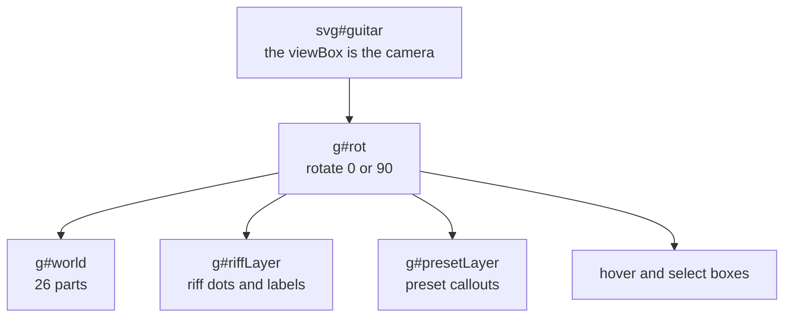

- **Storage.** The page keeps 4 values in the browser and nothing on a
  server:

| Key | Holds |
| --- | --- |
| `sixmart.state` | The current control setting |
| `sixmart.open` | Which panel sections are open |
| `sixmart.presets` | The saved presets |
| `sixmart.view` | Upright or worn |

## Run it and change it

```bash
git clone https://github.com/jeanfbrito/sixmart.git
cd sixmart
open index.html        # or double-click the file
```

The repository has no test suite. [AGENTS.md](AGENTS.md) tells how to
check a change in headless Chrome: screenshots, JavaScript errors, phone
width and interaction tests.

After a visible change, make the README images again:

```bash
node tools/shots.mjs              # all images
node tools/shots.mjs riff part    # only these
```

The script needs Node 22 or later and Google Chrome. It uses pngquant
and ffmpeg when the computer has them.

| File | Content |
| --- | --- |
| [`index.html`](index.html) | The whole page |
| [`API.md`](API.md) | The preset and riff API, and the saved-preset file format |
| [`AGENTS.md`](AGENTS.md) | Guidance for coding agents |
| [`tools/shots.mjs`](tools/shots.mjs) | Makes the README images |
| [`docs/img/`](docs/img) | The README images |

## Sources

Each spec row in the page has a tag that tells where the value comes
from:

| Tag | Source |
| --- | --- |
| **LISTING** | The retailer listing |
| **PHOTO** | Seen or measured on the owner's photos |
| **REFERENCE** | A general Strat setup value |
| **INFERRED** | Worked out, not checked on the guitar |

> [!IMPORTANT]
> - Nobody checked the guitar's manual for this page.
> - The song riffs are common learning versions. Nobody checked them note
>   for note against the recordings. The exercises, chord shapes and
>   melodies are exact.
> - The page makes no sound.

## Credits

- Tagima and Sixmart are trademarks of their owners. This page is a
  personal project about one guitar, not a Tagima product.
- The headstock logo uses [Yellowtail](https://fonts.google.com/specimen/Yellowtail)
  by Astigmatic (Apache License 2.0), from Google Fonts.

[api]: https://jeanfbrito.github.io/sixmart/#api
[part-bridge]: https://jeanfbrito.github.io/sixmart/#bridge
[part-neck]: https://jeanfbrito.github.io/sixmart/#neck
[part-tuners]: https://jeanfbrito.github.io/sixmart/#tuners
[p-plain-clean]: https://jeanfbrito.github.io/sixmart/#pickup=4&effects=off&mode=clean&volume=10&tone=8&delay=0&reverb=0&title=Plain+clean&note=Effects+off%3A+the+guitar+as+a+passive+Strat.
[p-ambient-clean]: https://jeanfbrito.github.io/sixmart/#pickup=5&effects=on&mode=clean&volume=8&tone=7&delay=4&reverb=7&title=Ambient+clean&note=Neck+pickup+with+room+for+arpeggios.
[p-blues-drive]: https://jeanfbrito.github.io/sixmart/#pickup=1&effects=on&mode=over&volume=7&tone=6&delay=2&reverb=3&title=Blues+overdrive&note=Light+crunch+on+the+bridge+humbucker.
[p-lead-dist]: https://jeanfbrito.github.io/sixmart/#pickup=1&effects=on&mode=dist&volume=10&tone=5&delay=5&reverb=4&title=Lead+distortion&note=Full+output+with+a+touch+of+delay.
[r-open-strings]: https://jeanfbrito.github.io/sixmart/#riff=6/0+5/0+4/0+3/0+2/0+1/0+%7C+1/0+2/0+3/0+4/0+5/0+6/0&title=Open+strings&note=Pick+each+string+once%2C+thickest+to+thinnest+and+back.+Learn+the+names+E+A+D+G+B+E.&source=Exercise.+The+notes+are+exact.&bpm=60&pickup=5&effects=off&volume=8&tone=8
[r-chromatic]: https://jeanfbrito.github.io/sixmart/#riff=6/1+6/2+6/3+6/4+%7C+5/1+5/2+5/3+5/4+%7C+4/1+4/2+4/3+4/4+%7C+3/1+3/2+3/3+3/4+%7C+2/1+2/2+2/3+2/4+%7C+1/1+1/2+1/3+1/4&title=Chromatic+warm-up+1-2-3-4&note=One+finger+per+fret%3A+first+finger+on+fret+1%2C+fourth+finger+on+fret+4.+Every+string%2C+low+E+to+high+e.&source=Exercise.+The+notes+are+exact.&bpm=70&pickup=5&effects=off&volume=8&tone=8
[r-em-pentatonic]: https://jeanfbrito.github.io/sixmart/#riff=6/0+6/3+5/0+5/2+4/0+4/2+3/0+3/2+2/0+2/3+1/0+1/3+%7C+1/0+2/3+2/0+3/2+3/0+4/2+4/0+5/2+5/0+6/3+6/0&title=E+minor+pentatonic+scale&note=Open+position%2C+up+and+back+down.+The+first+scale+most+players+learn.&source=Exercise.+The+notes+are+exact.&bpm=80&pickup=5&effects=off&volume=8&tone=8
[r-am-pentatonic]: https://jeanfbrito.github.io/sixmart/#riff=6/5+6/8+5/5+5/7+4/5+4/7+3/5+3/7+2/5+2/8+1/5+1/8+%7C+1/5+2/8+2/5+3/7+3/5+4/7+4/5+5/7+5/5+6/8+6/5&title=A+minor+pentatonic%2C+box+1&note=The+shape+behind+most+blues+and+rock+solos.+First+finger+on+fret+5%2C+up+and+back+down.&source=Exercise.+The+notes+are+exact.&bpm=80&pickup=1&effects=on&mode=over&volume=7&tone=6&delay=2&reverb=3
[r-c-major]: https://jeanfbrito.github.io/sixmart/#riff=5/3+4/0+4/2+4/3+3/0+3/2+2/0+2/1+%7C+2/0+3/2+3/0+4/3+4/2+4/0+5/3&title=C+major+scale&note=Open+position%3A+do+re+mi+fa+sol+la+ti+do%2C+up+and+back+down.&source=Exercise.+The+notes+are+exact.&bpm=80&pickup=5&effects=off&volume=8&tone=8
[r-open-chords]: https://jeanfbrito.github.io/sixmart/#riff=%5BEm%3A+6/0+5/2+4/2+3/0+2/0+1/0%5D+%7C+%5BAm%3A+5/0+4/2+3/2+2/1+1/0%5D+%7C+%5BC%3A+5/3+4/2+3/0+2/1+1/0%5D+%7C+%5BG%3A+6/3+5/2+4/0+3/0+2/0+1/3%5D+%7C+%5BD%3A+4/0+3/2+2/3+1/2%5D+%7C+%5BE%3A+6/0+5/2+4/2+3/1+2/0+1/0%5D+%7C+%5BA%3A+5/0+4/2+3/2+2/2+1/0%5D&title=Seven+open+chords&note=Em%2C+Am%2C+C%2C+G%2C+D%2C+E+and+A%3A+the+first+chord+shapes+most+players+learn.+Do+not+play+a+string+that+has+no+dot.&source=Standard+open+chord+shapes.+Exact.&bpm=30&pickup=3&effects=off&volume=8&tone=7
[r-four-chords]: https://jeanfbrito.github.io/sixmart/#riff=%5BG%3A+6/3+5/2+4/0+3/0+2/0+1/3%5D+%7C+%5BD%3A+4/0+3/2+2/3+1/2%5D+%7C+%5BEm%3A+6/0+5/2+4/2+3/0+2/0+1/0%5D+%7C+%5BC%3A+5/3+4/2+3/0+2/1+1/0%5D&title=Four+chords%3A+G%2C+D%2C+Em%2C+C&note=The+progression+behind+hundreds+of+pop+songs.+Strum+each+chord+four+times%2C+then+change.&source=Standard+open+chord+shapes.+Exact.&bpm=30&pickup=4&effects=on&mode=clean&volume=7&tone=7&delay=2&reverb=4
[r-twinkle]: https://jeanfbrito.github.io/sixmart/#riff=5/3+5/3+3/0+3/0+3/2+3/2+3/0+%7C+4/3+4/3+4/2+4/2+4/0+4/0+5/3&title=Twinkle%2C+Twinkle%2C+Little+Star&note=Traditional.+The+melody+on+the+A%2C+D+and+G+strings.&source=Public+domain+melody.+The+notes+are+exact.+The+rhythm+is+not+shown.&pickup=5&effects=off&volume=8&tone=8
[r-ode-to-joy]: https://jeanfbrito.github.io/sixmart/#riff=1/0+1/0+1/1+1/3+%7C+1/3+1/1+1/0+2/3+%7C+2/1+2/1+2/3+1/0+%7C+1/0+2/3+2/3&title=Ode+to+Joy&note=Beethoven.+The+melody+on+the+two+highest+strings.&source=Public+domain+melody.+The+notes+are+exact.+The+rhythm+is+not+shown.&bpm=100&pickup=5&effects=on&mode=clean&volume=7&tone=7&delay=3&reverb=5
[r-happy-birthday]: https://jeanfbrito.github.io/sixmart/#riff=3/0+3/0+3/2+3/0+2/1+2/0+%7C+3/0+3/0+3/2+3/0+2/3+2/1+%7C+3/0+3/0+1/3+1/0+2/1+2/0+3/2+%7C+1/1+1/1+1/0+2/1+2/3+2/1&title=Happy+Birthday&note=The+melody+on+the+three+highest+strings.&source=Public+domain+melody.+The+notes+are+exact.+The+rhythm+is+not+shown.&pickup=5&effects=on&mode=clean&volume=7&tone=7&delay=2&reverb=4
[r-smoke]: https://jeanfbrito.github.io/sixmart/#tab=e%7C--------------------------------%0AB%7C--------------------------------%0AG%7C--------------------------------%0AD%7C--------------------------------%0AA%7C--------------------------------%0AE%7C--0--3--5---0--3--6-5---0--3--5---3--0--&title=Smoke+on+the+Water&note=Deep+Purple.+One-string+version+on+the+low+E+string.&source=Common+learning+version.+Not+checked+note+for+note+against+the+recording.&bpm=110&pickup=1&effects=on&mode=over&volume=8&tone=6&delay=0&reverb=3
[r-seven-nation]: https://jeanfbrito.github.io/sixmart/#riff=5/7+5/7+5/10+5/7+5/5+5/3+5/2&title=Seven+Nation+Army&note=The+White+Stripes.+The+main+riff%2C+all+on+the+A+string.+Hold+the+first+note.&source=Common+learning+version.+Not+checked+note+for+note+against+the+recording.&bpm=100&pickup=1&effects=on&mode=dist&volume=9&tone=5&delay=0&reverb=2
[r-iron-man]: https://jeanfbrito.github.io/sixmart/#riff=%5BB5%3A+5/2+4/4%5D+%7C+%5BD5%3A+5/5+4/7%5D+%5BD5%3A+5/5+4/7%5D+%5BE5%3A+5/7+4/9%5D+%5BE5%3A+5/7+4/9%5D+%7C+%5BG5%3A+5/10+4/12%5D+%5BF%235%3A+5/9+4/11%5D+%5BG5%3A+5/10+4/12%5D+%5BF%235%3A+5/9+4/11%5D+%5BG5%3A+5/10+4/12%5D+%5BF%235%3A+5/9+4/11%5D+%7C+%5BD5%3A+5/5+4/7%5D+%5BD5%3A+5/5+4/7%5D+%5BE5%3A+5/7+4/9%5D+%5BE5%3A+5/7+4/9%5D&title=Iron+Man&note=Black+Sabbath.+Two-note+power+chords%3A+first+finger+on+the+A+string%2C+third+finger+on+the+D+string.&source=Common+learning+version.+Not+checked+note+for+note+against+the+recording.&bpm=80&pickup=1&effects=on&mode=dist&volume=9&tone=5&delay=0&reverb=2
[r-teen-spirit]: https://jeanfbrito.github.io/sixmart/#riff=%5BF5%3A+6/1+5/3+4/3%5D+%7C+%5BBb5%3A+5/1+4/3+3/3%5D+%7C+%5BAb5%3A+6/4+5/6+4/6%5D+%7C+%5BDb5%3A+5/4+4/6+3/6%5D&title=Smells+Like+Teen+Spirit&note=Nirvana.+The+four+power-chord+shapes+of+the+intro%2C+one+per+bar.+The+song+strums+each+one+in+a+rhythm.&source=Chord+shapes+F5%2C+B%E2%99%AD5%2C+A%E2%99%AD5+and+D%E2%99%AD5.+The+rhythm+is+not+shown.&bpm=50&pickup=1&effects=on&mode=dist&volume=9&tone=6&delay=0&reverb=2
